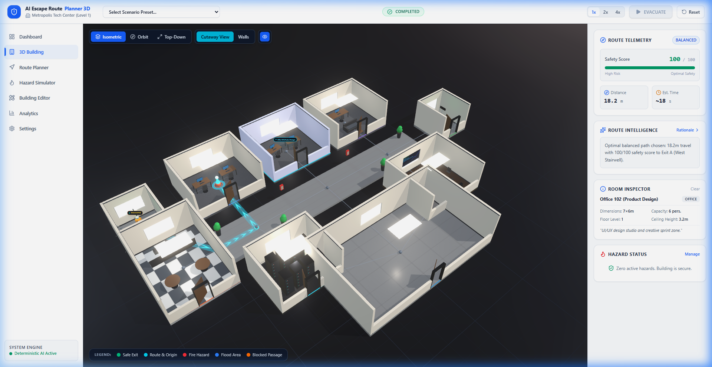
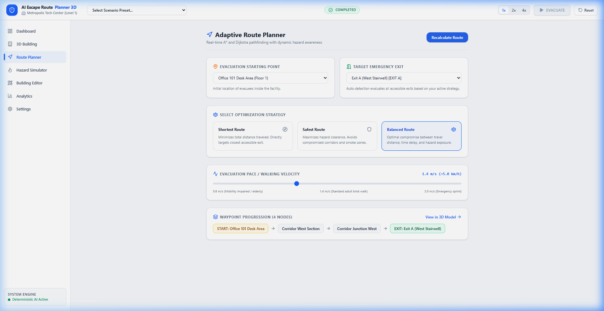
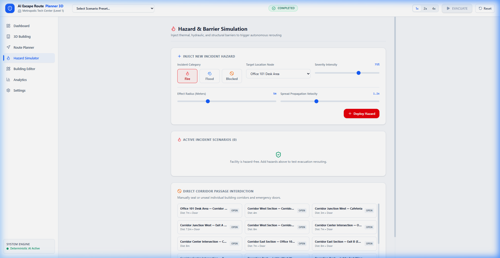
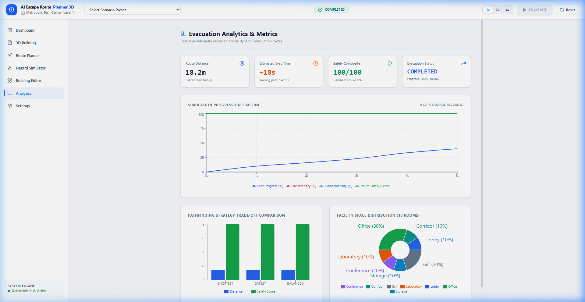
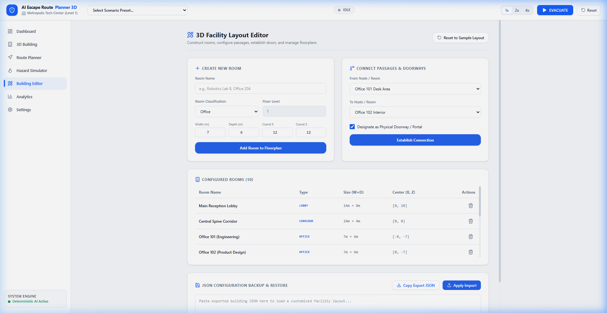

# AI Escape Route Planner 3D

> **Autonomous Emergency Building Evacuation Simulation & Dynamic Pathfinding Platform**

AI Escape Route Planner 3D is a modern, professional architectural visualization and emergency evacuation management platform. It models multi-room corporate and academic facilities, simulates dynamic environmental hazards (thermal fire, hydraulic flooding, structural barricades), computes optimal escape paths using **A\*** and **Dijkstra's** algorithms, and dynamically reroutes occupants in real time when safety conditions change.

The application runs **100% locally in the frontend** with zero external dependencies, no backend server, no database, and no cloud/AI API requirements.

---

## Visual Showcase

| 3D Architectural View | Live Evacuation Simulation |
| :---: | :---: |
|  |  |
| **Operations Dashboard** | **Adaptive Route Planner** |
|  |  |
| **Hazard & Barrier Simulation** | **Analytics & Telemetry** |
|  |  |

---

## Core Topics & Capabilities

### 1. 3D Architectural Facility Modeling


- **Dark Cinematic Viewport**: Features a `#0A0F1C` background with atmospheric depth fog (`#0A0F1C`, near 60, far 160) and a dark reflective ground plane (`MeshStandardMaterial` `#0D1424`, roughness 0.4, metalness 0.6) with a subtle distance-fading coordinate grid.
- **Auto-Fit Camera Framing**: Automatically calculates the building bounding box using `@react-three/drei` `<Bounds fit clip observe margin={1.1}>` so the structure fills ~75% of the viewport at an elevated isometric perspective (~50° polar angle).
- **Solid Opaque Geometry**: Real 0.2m thick perimeter walls with physical cutouts for doorways, window openings with architectural glass (`MeshPhysicalMaterial`), and solid floor slabs.
- **Realistic PBR Floor Materials (No flat saturated color blocks)**:
  - **Corridors & Lobby**: Polished concrete (`#8A8F98`), roughness 0.3, with expansion joints and aggregate mineral speckling.
  - **Offices**: Neutral grey carpet (`#4A4F5A`), roughness 0.95, with micro-fiber noise.
  - **Cafeteria**: 2×2 repeat checker tile (`#E2E8F0` and `#4B5563` with grout seams).
  - **Datacenter**: Dark anti-static raised-floor tile grid (`#1C2029`).
  - **Conference Room**: Dark mahogany wood planks (`#3B2A20`), roughness 0.5.
  - **Room Identity**: Preserved via thin 0.05m baseboard perimeter strips at room boundaries rather than full-floor color overlays.
- **Architectural Trims**: Off-white matte walls (`#E8E6E1`) with 0.12m dark baseboards (`#2C313D`) at floor joins and 0.08m ceiling trims.
- **High-Contrast Furniture & Props**:
  - **Workstations**: Rich walnut desks (`#6B4F3A`), graphite ergonomic chairs (`#2B2F38`), black monitors with glowing blue terminal screens.
  - **Executive Suite**: Leather lounge sofa, coffee table, and executive workspace.
  - **Datacenter**: 42U server rack units with animated blinking status LEDs.
  - **Conference Room**: Solid boardroom table with 12 chairs and a wall-mounted presentation display.
  - **Cafeteria**: Dining tables, quartz-top service bar, and espresso machine.
  - **Emergency Exits**: Concrete stairwells with stainless-steel handrails and glowing green exit signage.
- **PBR Wooden Doors**: Walnut wood door leaves (`#5A3D28`) with visible metal frames and chrome lever handles, with doors rendered open at 70° (1.22 rad) for architectural realism.
- **Contextual Room Labels**: Labels appear only on hover or selection as sleek 12px dark pills (`#0A0F1C`/95) with room-type indicator dots to prevent clutter.

---

### 2. Autonomous Evacuation Simulation & Live Telemetry


- **Glowing Cyan Evacuation Ribbon**: Safe escape paths are rendered as a `#22D3EE` ribbon (emissive 2.0, bloom-enabled) hovering 0.05m above the floor with animated forward chevrons.
- **Animated Walking Human Evacuee**: Fully rigged 3D low-poly human character with vibrant orange body (`#F59E0B`), hi-vis bands, swinging limb walk cycle, and live floating status pill.
- **Real-Time Telemetry Tracking**:
  - Safety score (0–100 composite index).
  - Total distance and estimated evacuation transit time.
  - Live progress percentage and meters traveled.
  - Active hazard exposure percentage.
- **Simulation Controls**: Evacuate (Play), Pause, Resume, Reset, and Speed Multipliers (`1x`, `2x`, `4x`).

---

### 3. Operations Dashboard & Emergency Scenarios


- **Commercial SaaS Light UI**: Modern light dashboard built with `#F5F7FA` canvas, `#FFFFFF` cards, and subtle `#E2E8F0` borders.
- **Facility KPI Metrics**: Immediate visibility into total rooms, active exits, active hazards, blocked corridors, and safety scores.
- **Predefined Emergency Scenarios**:
  1. **Office Building (Baseline)** – Metropolis Tech Center ground floor, standard corporate occupancy, zero active hazards.
  2. **School Complex (Baseline)** – Horizon Science Academy with laboratories, central atrium, and three perimeter exits.
  3. **Fire Emergency in West Corridor** – Severe electrical fire in the West corridor forcing evacuation through the East Plaza Exit.
  4. **Blocked Exit (Structural Barrier)** – Structural collapse at Exit A doorway, auto-diverting to Exit B.
  5. **Water Main Burst & Corridor Flooding** – Central corridor flooding requiring evacuees to detour through the Main Lobby.

---

### 4. Multi-Strategy Route Planning & Waypoint Progression


- **A\* and Dijkstra Engines**: Accelerated Euclidean heuristic pathfinding paired with complete edge cost evaluation.
- **Three Optimization Strategies**:
  - **Shortest Route**: Minimizes total travel distance directly to the closest accessible emergency exit.
  - **Safest Route**: Heavily penalizes proximity to thermal zones and water levels, steering evacuees away from danger.
  - **Balanced Route**: Optimal mathematical trade-off between transit distance, estimated time, and hazard exposure.
- **Auto-Exit Failover**: Automatically evaluates all building exits and selects the best accessible exit based on real-time corridor status.
- **Walking Velocity Configuration**: Range slider to configure walking velocity from 0.6 m/s (mobility-impaired) to 3.0 m/s (emergency sprint).
- **Waypoint Progression**: Interactive breadcrumb breakdown displaying each node from origin to destination exit.

---

### 5. Hazard Propagation & Physical Corridor Interdiction


- **Incident Injection Form**: Deploy customized thermal Fire, hydraulic Flood, or structural Blocked incidents at any navigation node.
- **Dynamic Spread Simulation**: Real-time intensity calculation, radial expansion, and propagation velocity controls.
- **Direct Corridor Passage Interdiction**: Manually seal or unseal individual building corridors and emergency doors.
- **Dynamic Recalculation**: If an evacuee is in transit and the path ahead becomes compromised, forward motion halts immediately and the engine reroutes from the evacuee's *current coordinate*.

---

### 6. Telemetry Analytics & Route Intelligence


- **Progression Timeline (Recharts)**: Real-time multi-line chart recording evacuation progress, route safety score, fire intensity, and flood levels over time.
- **Strategy Comparison Matrix**: Bar chart comparing Distance vs Safety Score across Shortest, Safest, and Balanced routes.
- **Facility Space Distribution**: Donut chart breaking down room classifications across the building.
- **Deterministic Route Intelligence**: Modal providing clear mathematical rationale explaining why the primary route was chosen over alternatives (distance delta vs safety score gain).

---

### 7. Facility Layout Editor & JSON Architecture



- **3D Room Creation**: Construct new rooms with custom dimensions, floor coordinates, and functional classifications.
- **Corridor & Doorway Connections**: Establish bidirectional traversable links and designate doorways between navigation nodes.
- **Room Management Table**: Inspect and delete rooms with live 3D synchronization.
- **JSON Import / Export**: Complete floorplan backup and restore with schema validation and one-click clipboard export.

---

## Technology Stack

| Layer | Technologies |
|---|---|
| **Core Framework** | React 19, TypeScript, Vite |
| **3D Rendering** | Three.js, React Three Fiber (`@react-three/fiber`), React Three Drei (`@react-three/drei`) |
| **Post-Processing** | `@react-three/postprocessing`, `postprocessing` (SSAO, Bloom, Vignette) |
| **Styling & Theme** | Tailwind CSS v4, Light Theme SaaS Dashboard, Dark Cinematic Viewport |
| **State Management** | Zustand 5 |
| **Icons & Visuals** | Lucide React |
| **Telemetry & Charts** | Recharts 3 |
| **Testing** | Vitest 5 |

---

## Project Structure

```
src/
├── types/
│   └── index.ts                 # Core types (Room, NavNode, NavEdge, Hazard, RouteResult, Simulation)
├── engine/
│   ├── graph/
│   │   ├── navigationGraph.ts   # Graph data structure, adjacency list, and dynamic hazard costs
│   │   └── graphValidation.ts  # Connectivity validation, orphan detection, and reachability analysis
│   ├── pathfinding/
│   │   ├── astar.ts             # A* algorithm with 3D Euclidean heuristic
│   │   ├── dijkstra.ts          # Dijkstra algorithm for single and multi-exit exploration
│   │   └── routePlanner.ts      # Multi-strategy coordination & auto-exit selection
│   ├── hazards/
│   │   └── hazardEngine.ts      # Fire spread, flood level calculations, and threshold blocking
│   ├── simulation/
│   │   └── evacuationEngine.ts  # Waypoint motion interpolation, speed scaling, and obstacle detection
│   └── routing/
│       ├── routeScoring.ts      # ETA, stair/turn delays, exposure calculation, and safety score
│       └── routeExplanation.ts  # Deterministic route intelligence reasoning generator
├── data/
│   ├── sampleBuildings.ts       # Floorplans (Metropolis Tech Center & Horizon Science Academy)
│   └── sampleScenarios.ts       # 5 predefined emergency incident presets
├── store/
│   └── useAppStore.ts           # Central Zustand store connecting 3D scene, engine, and UI
├── utils/
│   └── proceduralTextures.ts   # PBR textures (polished concrete, carpet, wood, checker tile, datacenter)
├── components/
│   ├── building/                # Three.js 3D Viewport, Room meshes, Furniture, Camera, Route, Evacuee
│   ├── layout/                  # Clean white Header and Sidebar navigation
│   ├── dashboard/               # Overview KPI telemetry and Right-side Information Panel
│   ├── routes/                  # Route Planner panel & Route Intelligence modal
│   ├── hazards/                 # Hazard deployment and corridor interdiction panel
│   ├── editor/                  # 3D facility layout editor and JSON backup/restore
│   ├── analytics/               # Recharts telemetry progression and comparison charts
│   ├── settings/                # Viewport toggles and measurement units
│   └── ui/                      # Floating Toast alert system
└── test/
    ├── astar.test.ts            # A* unit tests (normal, blocked edges, hazard penalties)
    ├── dijkstra.test.ts         # Dijkstra shortest path & all-node calculations
    ├── hazards.test.ts          # Hazard penalty calculations and propagation steps
    ├── dynamicRerouting.test.ts # In-transit halt and alternative exit failover tests
    └── graphValidation.test.ts  # Graph connectivity and validation checks
```

---

## Installation & Running Instructions

### Prerequisites
- **Node.js** (v18 or higher recommended; verified on Node v24)
- **npm** (v9 or higher)

### 1. Installation
Clone or navigate to the project directory and install dependencies:
```bash
npm install
```

### 2. Run Local Development Server
Start the local Vite development server:
```bash
npm run dev
```
Open [http://localhost:5173](http://localhost:5173) in your web browser.

### 3. Run Automated Tests
Execute the Vitest test suite (17/17 automated unit and integration tests):
```bash
npm test
```
To run tests in watch mode:
```bash
npm run test:watch
```

### 4. Build for Production
Create an optimized production bundle:
```bash
npm run build
```
Preview the production build locally:
```bash
npm run preview
```

---

## Pathfinding Algorithms & Mathematical Formulas

### 1. A* Algorithm (`astar.ts`)
The A* search algorithm evaluates nodes by combining the exact path cost from the start node $g(n)$ with an admissible heuristic estimate to the goal $h(n)$:

$$f(n) = g(n) + h(n)$$

- **Heuristic Function $h(n)$**: 3D Euclidean distance between coordinates:
  $$h(n) = \sqrt{(x_n - x_{goal})^2 + (y_n - y_{goal})^2 + (z_n - z_{goal})^2}$$
- **Edge Cost Function $g(n)$**: Geometric distance plus dynamic environmental hazard penalties determined by the selected strategy.

### 2. Route Optimization Strategies
- **Shortest**:
  $$\text{Cost} = \text{Distance} + (\text{Penalty} \ge 95 \,?\, \infty : \text{Penalty} \times 0.1)$$
- **Safest**:
  $$\text{Cost} = \text{Distance} + (\text{Penalty} \times 8.0)$$
- **Balanced**:
  $$\text{Cost} = \text{Distance} + (\text{Penalty} \times 2.5)$$

### 3. Safety Score Formula
$$\text{Safety Score} = \max(0, \min(100, 100 - (\text{Peak Hazard} \times 0.65 + \text{Average Hazard} \times 0.35)))$$

---

## License
MIT License. Built for emergency response simulation, architectural analysis, and academic research.
